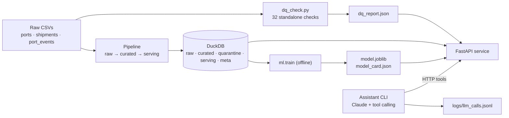

# Supply Chain Intelligence Mini-Platform

[](https://github.com/MAHArishbah/SCI_MiniPlatfrom/actions/workflows/ci.yml)

A thin, end-to-end slice of a supply-chain intelligence platform: standalone data-quality checks on raw
shipping data, a layered DuckDB data product, a booking-time delay-risk model, a FastAPI service, and a
Claude-powered assistant that answers questions through tool calls.

**Stack:** Python 3.12 · FastAPI · DuckDB · pandas · scikit-learn · Anthropic Claude · pytest · ruff · Docker Compose · GitHub Actions

---

## 1. Getting started

```bash
git clone https://github.com/MAHArishbah/SCI_MiniPlatfrom.git && cd SCI_MiniPlatfrom
docker compose up --build
```

That one command builds the image, runs the standalone DQ check, builds the warehouse from the raw CSVs, loads
the committed model and serves the API on **http://localhost:8000** (interactive docs at `/docs`). First build
takes ~2–4 minutes; start-up after that takes ~10 seconds.

```bash
curl localhost:8000/health
curl localhost:8000/shipments/SHP-00421
curl "localhost:8000/shipments?origin=CNSHA&destination=NLRTM&status=DELAYED&page_size=5"
curl localhost:8000/routes/CNSHA/NLRTM/stats
curl -X POST localhost:8000/predict-delay -H 'Content-Type: application/json' -d '{"shipment_id": "SHP-00421"}'
curl localhost:8000/data-quality/report
```

**GenAI assistant** (needs an Anthropic API key):

```bash
cp .env.example .env            # add ANTHROPIC_API_KEY
docker compose run --rm assistant
> Which routes have had the highest average delay this quarter?
```

**Tests:**

```bash
make install && make test       # 125 unit tests, ~3 s, no infrastructure
make up && make test-integration   # real HTTP against the running container
```

**Without Docker:** `make install && make run`. Every step also runs on its own:

| Step | Command |
|---|---|
| Standalone DQ check (raw CSVs only) | `python dq_check.py --input ./data/raw` |
| Build warehouse (idempotent) | `python -m sci.pipeline.build` |
| Retrain model (optional; artefact is committed) | `python -m sci.ml.train` |
| API | `uvicorn sci.api.main:app --port 8000` |
| Assistant | `python -m sci.assistant.cli -q "On-time rate Shanghai to Rotterdam?"` |

---

## 2. Architecture



Design points:

- **DQ is independent.** `dq_check.py` reads the raw files directly and never touches the warehouse. The pipeline
  *imports* the same check functions to apply remediations, so detection and remediation share one definition
  of every rule, but nothing in DQ depends on the pipeline.
- **The assistant uses the public API**, not the database. Its tools hit the same contract any client uses, so
  validation, logging and error handling apply to it too.
- **Training is offline.** The API loads `artifacts/model.joblib` at start-up and never retrains.

### Repository layout

```
dq_check.py              standalone DQ entry point
sci/dq/                  checks.py (32 checks), rules.py (shared rules), runner.py (CLI + report)
sci/pipeline/            transform.py (pure raw→curated functions), build.py (DuckDB layers, atomic swap)
sci/ml/                  features.py (leakage-guarded), train.py, predict.py
sci/api/                 main.py (app, middleware, routes), repository.py (all SQL), schemas.py, errors.py
sci/assistant/           tools.py (tool schemas + validation), agent.py (loop, guardrails, logging), cli.py
artifacts/               model.joblib, model_card.json, dq_report.json (committed)
data/raw/                supplied CSVs
tests/unit/              125 tests on hand-made fixture CSVs (tests/fixtures/raw)
tests/integration/       end-to-end HTTP tests against the running container
```

---

## 3. Tech choices

| Area | Choice | Why |
|---|---|---|
| API | **FastAPI** | Typed request/response models give validation and OpenAPI docs for free; TestClient makes in-process API tests fast. |
| Data store | **DuckDB** (single file) | Embedded columnar SQL: zero ops, fast aggregations, perfect for ~30k rows and analytical queries. Schemas give clean layer separation. Read-only connections let several API workers share the file. |
| Transforms | **pandas** (pure functions) | Every cleaning decision is a unit-testable function; at this scale clarity beats performance. |
| ML | **scikit-learn logistic regression** | Interpretable, well-calibrated family, fast to train. A gradient-boosting model is trained alongside purely for comparison. |
| LLM | **Anthropic Claude** (default `claude-haiku-5-5`, configurable via `ANTHROPIC_MODEL`) | Reliable tool use at very low cost; a stronger model is a one-variable switch. |
| Tests | **pytest**, FastAPI TestClient, httpx `MockTransport` | Unit tests mock all external dependencies and run in ~3 s; integration tests use real HTTP. |
| Lint/format | **ruff** | One fast tool for both. |
| CI | **GitHub Actions** | Native to GitHub; runs Docker Compose for the integration job. |
| Packaging | **Docker + Compose** | One command from clone to running service. |

**At 100× the volume** (~500k shipments, ~2.5M events) DuckDB itself is still comfortable on one machine. What
changes is the pipeline: full rebuilds become incremental loads (date-partitioned Parquet plus `MERGE` on keys),
transforms move from pandas into SQL (DuckDB SQL or dbt) so they run out-of-core, and the warehouse build moves
out of API start-up into a scheduled job. If many services needed concurrent writes or low-latency point lookups
under load, I would put the serving layer in PostgreSQL and keep DuckDB/Parquet for analytics.

**Consciously not done:** a UI; authentication; Kubernetes/Terraform; a real streaming stack (the event feed is
processed as an idempotent batch, see Scaling); hyperparameter tuning (there is no signal to tune, see Part 3);
an LLM evaluation harness; async DB access. Each is listed in "If I had more time" or "Scaling".

---

## 4. Data quality summary

`python dq_check.py --input ./data/raw` runs **32 checks** (18 fail, 14 pass; passing checks are reported too) and
writes `artifacts/dq_report.json`, also served at `GET /data-quality/report`. Each entry records the check name,
detection method, rows affected, % of total, severity, recommended action and sample keys. `--fail-on-critical`
turns it into a CI gate.

| # | Check | Rows | Severity | Decision and reasoning |
|---|---|---:|---|---|
| 1 | `shipments.duplicate_rows_exact` | 8 | warning | **Drop** extra copies; no information lost. |
| 2 | `shipments.duplicate_id_conflicting` | 20 | critical | **Fix:** keep the most complete copy per id (fewest blanks, ties go to first seen). 15 of the 20 differ only by a blank `cargo_type`, so this recovers every one. 5 differ by 1–2 t of weight; we keep the first and flag it. |
| 3 | `shipments.unknown_port_code` (XXTST, ZZZZZ, UNKNW) | 95 | critical | **Quarantine:** route metrics and the model need real ports. |
| 4 | `shipments.cargo_type_non_canonical` (case/whitespace) | 261 | warning | **Fix:** normalize to the 10 canonical labels. |
| 5 | `shipments.cargo_type_missing` | 15 | warning | **Fix:** all recovered by #2; any future blanks become `Unknown`. |
| 6 | `shipments.weight_tons_missing` | 73 | warning | **Flag**, keep NULL; the model imputes the training median. |
| 7 | `shipments.weight_tons_negative` | 36 | warning | **NULL + flag:** flipping the sign would be a silent guess. |
| 8 | `shipments.container_count_zero` | 23 | warning | **NULL + flag.** |
| 9 | `shipments.container_count_outlier` (593–996 vs normal max 40) | 17 | warning | **NULL + flag.** Detected with a data-driven IQR fence (Q3 + 3·IQR), not a hard-coded limit. |
| 10 | `shipments.status_non_canonical` (COMPLETED, Complete, delivered, N/A, blank) | 146 | warning | **Fix:** completion variants become `DELIVERED`, blanks become `UNKNOWN`. |
| 11 | `shipments.missing_actuals_non_cancelled` | 146 | critical | Same rows as #10. **Keep and flag** (they are real bookings) but exclude them from delay metrics and ML labels. |
| 12 | `shipments.actual_departure_before_booking` | 39 | warning | **NULL `actual_departure` + flag:** temporally impossible. The arrival-based delay is kept. |
| 13 | `ports.country_missing` (Antwerp) | 1 | warning | **Fix** from the UN/LOCODE prefix (BE = Belgium). |
| 14 | `port_events.event_id_collision` (103 ids) | 206 | warning | **Keep all:** they are different events. Add a deterministic surrogate key `event_sk`. |
| 15 | `port_events.event_type_missing` | 140 | warning | **Fix:** set to `UNKNOWN`; `delay_minutes` is still usable. |
| 16 | `port_events.unknown_vessel` (VSL-0000, VSL-9999) | 207 | warning | **Quarantine:** placeholder vessels cannot be linked to any shipment. |
| 17 | `port_events.delayed_event_zero_minutes` | 12 | info | **Flag only:** we cannot tell which field is wrong. |
| 18 | `port_events.notes_missing` | 1,913 | info | Keep NULL; notes are optional. |

Passing checks include unparseable timestamps, planned/actual timeline order, origin = destination, cancelled
with actuals, status contradicting the computed delay, duplicate port codes, congestion score range, unknown event
ports and negative delays.

**Result:** 4,906 curated shipments, 122 quarantined (8 exact duplicates, 20 conflicting duplicates, 94 unknown
ports); 24,793 curated events, 207 quarantined. Quarantined rows keep their raw values plus a
`quarantine_reason`, so nothing is silently lost.

**Observed but not acted on:** weight per container is implausible for most rows (median ~70 t versus a ~30 t
physical maximum). It is systematic across the dataset, so I read it as a property of the generator rather than an
injected defect. Also, `status = DELAYED` is exactly `delay > 24h`, so status is a restatement of the label and is
never used as a feature.

---

## Data model

| Schema.table | Grain / key | Notes |
|---|---|---|
| `raw.ports`, `raw.shipments`, `raw.port_events` | one row per source row (`_source_row`) | Strings exactly as delivered, plus `_source_file` and `_ingested_at`. |
| `curated.ports` | `port_code` (PK) | Country filled, `utc_offset_hours` parsed, `dq_flags`. |
| `curated.shipments` | `shipment_id` (PK) | Typed, deduplicated, normalized. Derived fields: `actual_delay_hours`, `on_time_flag` (≤ 24h; NULL when unknown), `route_key`, `transit_days_planned`, `transit_days_actual`, `booking_lead_days`, `departure_delay_hours`, `is_labelled`, plus `dq_flags` (list). FKs: `origin_port`, `destination_port` → `curated.ports`. |
| `curated.port_events` | `event_sk` (PK) | `event_id` kept but is not unique. FKs: `port_code` → ports; `vessel_id` matches `shipments.vessel_id`. |
| `quarantine.shipments`, `quarantine.port_events` | source row | Raw values + `quarantine_reason`. |
| `serving.shipments` (view) | `shipment_id` | Curated shipments joined with port names: the API's read model. |
| `serving.route_daily_stats` | (`origin_port`, `destination_port`, `departure_date`) | Pre-aggregated counts and delay sums. Any date-range route metric is a cheap sum over this table. |
| `meta.pipeline_runs` | `run_id` | Input file hashes and row counts per layer for the last build. |

**Idempotency:** each run rebuilds every layer from the raw files into a temporary DuckDB file and swaps it into
place with an atomic `os.replace`. Re-running gives identical tables (verified by `test_pipeline_is_idempotent`),
and readers never see a half-built database.

---

## API

| Method & path | Purpose | Notable responses |
|---|---|---|
| `GET /health` | Liveness + readiness: DB, model and DQ report status, version, git SHA, data coverage | 200 ok; 503 degraded |
| `GET /shipments/{id}` | Full curated record including `dq_flags` | 404 unknown or quarantined id |
| `GET /shipments` | Filters: `origin`, `destination`, `status`, `date_from`, `date_to` (on planned departure); `page`, `page_size` ≤ 100 | 400 bad date range; 404 unknown port; 422 bad enum |
| `GET /routes/{origin}/{destination}/stats` | Shipment, completed and cancelled counts, average delay hours, on-time rate; optional date window | 404 unknown port; 200 with zero counts for a valid empty window |
| `GET /routes/top` | Worst routes by average delay or on-time rate, with a `min_completed` floor | Used by the assistant |
| `GET /ports` | Port reference | |
| `POST /predict-delay` | Body is `{"shipment_id": ...}` or the booking-time fields of a new booking | 404 unknown id; 422 invalid booking |
| `GET /data-quality/report` | The DQ report JSON | 503 if not generated |

Every error uses one shape: `{"error": {"code", "message", "request_id", "details?"}}`. Every request is logged as
one JSON line with `method`, `path`, `status_code`, `latency_ms` and `request_id` (echoed in `X-Request-ID`).

---

## Part 3: ML and GenAI

### Delay-risk model

**Target:** arrival more than 24h after the planned arrival, predicted **at booking time**.

**Features** (`sci/ml/features.py`): origin and destination port, origin and destination region, cargo type, port
congestion scores, booking lead days, planned transit days, departure month (sin/cos) and weekday, container count
and log weight. `build_features` reads only an allow-list of booking-time columns and raises if any post-booking
column (actual times, status, delay) would reach the matrix. A unit test proves the features do not change when
the actuals are tampered with.

**Excluded on purpose:** `customer_id` (251 levels and ~18 rows each: memorization risk), `vessel_id` (assignment
can change after booking), `status` (it *is* the label), and port-event aggregates. I built as-of features (each
port's 30-day mean event delay before the booking date, with no look-ahead); their correlation with the label was
about 0.00, so they were dropped.

**Evaluation:** time-based split on `booking_date`. Train on 3,651 bookings (2024-06-01 to 2025-07-10), test on
the most recent 913 (2025-07-10 to 2025-10-14). Positive rate is 40.4% in both.

| Model (test set) | ROC AUC | PR AUC | Precision | Recall | F1 | Brier |
|---|---:|---:|---:|---:|---:|---:|
| Prior-only baseline | 0.500 | 0.404 | n/a (no positive predictions) | 0.000 | 0.000 | 0.241 |
| **Logistic regression (served)** | **0.511** (95% CI 0.471–0.547) | 0.418 | 0.398 | 0.371 | 0.384 | 0.250 |
| Gradient boosting (comparison only) | 0.521 | 0.426 | 0.443 | 0.106 | 0.171 | 0.244 |
| *Leakage reference: + departure delay* | *0.975* | | | | | |

TimeSeriesSplit CV AUC on the training window: 0.51, 0.51, 0.47, 0.50, 0.46.

**Honest reading:** the booking-time features carry essentially **no signal** for arrival delay in this dataset.
The bootstrap interval contains 0.5, CV folds hover around 0.5, and boosting is no better within noise. In
contrast, adding departure delay (known only after sailing) jumps AUC to 0.975, which is exactly the leakage the
brief warns about and why it is excluded. I also tried point-in-time historical delay rates per vessel, route,
customer, port and cargo type, computed only from shipments that had arrived before each booking. Each scored an
AUC between 0.46 and 0.52 on the test window. Arrival delay correlates 0.85 with departure delay but about 0.00
with planned transit time: in this data, delays are created at or after departure, so nothing known at booking
can predict them. With `class_weight="balanced"` the probabilities are pulled towards 0.5,
which is why the Brier score is worse than the prior baseline; the scores are a ranking, not calibrated
probabilities.

The endpoint still serves the model so the end-to-end slice works, and **every prediction response includes
`model_test_roc_auc`**, so callers (and the assistant) can see how little weight to give it. I would not put this
model in front of a business decision. The next step would be in-transit features (departure delay, port events
along the actual voyage) for a mid-voyage model, which is a different, legitimate product.

**Monitoring in production:**
- *Inputs:* PSI on route and cargo mix, lead time and transit time; share of unseen ports or cargo types; upstream DQ failure rates.
- *Outputs:* score distribution and predicted-positive rate per day.
- *Outcomes* (labels mature about one transit time after booking): rolling AUC, precision/recall, Brier and base delay rate on matured labels.
- *Retrain triggers:* rolling 4-week AUC within noise of 0.5 *or* below the last accepted model; any key-feature PSI > 0.2; base delay rate shifting > 5 points; plus a scheduled monthly retrain promoted only if it beats the current model on a held-out recent window (champion/challenger).

### GenAI assistant

`python -m sci.assistant.cli` (or `docker compose run --rm assistant`). The LLM is Anthropic Claude, default
`claude-haiku-5-5`, configurable via `ANTHROPIC_MODEL`.

**Tools** (the model decides when to call them; all go through the API):

| Tool | API call |
|---|---|
| `query_shipments(filters)` | `GET /shipments` (results compacted to the fields the model needs) |
| `get_route_stats(origin, destination, dates?)` | `GET /routes/{o}/{d}/stats` |
| `get_top_routes(order_by, dates?, min_completed)` | `GET /routes/top`, for "which routes had the highest delay" |
| `predict_delay(shipment_id)` | `POST /predict-delay` |

The system prompt carries the port name → code map and resolves "this quarter" relative to the latest date in the
data (it is historical), stating the assumption in the answer.

**Guardrails** (enforced in code, all unit-tested):
1. **Tool-call budget:** at most 6 tool executions and 8 model calls per question; then it stops with a safe fallback.
2. **Argument validation before any API call:** port codes must be in the reference list, shipment ids must match `SHP-NNNNN`, dates must be ISO, limits are capped. Bad arguments return a tool error the model can recover from; the API is never called.
3. **Grounded citations:** answers must cite their source tool as `[tool_name]`, and may only cite tools that actually ran. Any figure without a valid citation triggers one corrective retry, then a fallback ("I won't guess"). IDs and dates are not counted as figures.
4. **Domain scope:** the system prompt restricts it to shipping questions; off-domain requests get a one-line refusal.

**LLM observability:** every model call, tool call and final answer is appended to `logs/llm_calls.jsonl`. Each
model call records the full system prompt, the messages sent, the response, tokens and latency; each tool call
records its input, output, error flag and latency; each final answer records the guardrail events and the
estimated cost.

**Cost:** Claude Haiku 5.5 is priced at $0.10 per million input tokens and $0.50 per million output tokens for
prompts up to 100k tokens. A typical question takes 2–3 model calls, about 6–9k input tokens (system prompt and
tool schemas are re-sent each call) and about 400 output tokens, so **≈ $0.001 per question**. A Sonnet-class model
at $3/$15 would be ≈ $0.03. The exact cost is computed from real token usage and logged per question; prices are
set in `.env`.

---

## 5. Production support runbook

**After a deployment**
1. `curl -fsS http://<host>:8000/health` returns 200 with `"status": "ok"`, all three checks `ok`, the expected `version` and `git_sha`, and a plausible `data.shipments` count.
2. Smoke-test: `GET /shipments/SHP-00421` returns 200 and `POST /predict-delay {"shipment_id":"SHP-00421"}` returns 200 with the expected `model_version`.
3. Watch the request logs for a few minutes: `status_code >= 500` should be zero and p95 `latency_ms` flat versus the previous release.

**Likely failure modes**

| Symptom | Likely cause | Diagnosis |
|---|---|---|
| Container restarts or `/health` is 503 with `database: unavailable` | The warehouse build failed at start-up: missing or renamed CSV, schema change, bad data | `docker compose logs api`; look for the `pipeline_complete` line or a traceback before it. Run `python dq_check.py --input <dir> --fail-on-critical` against the new files. |
| `/predict-delay` returns 503 or 500 after a release | Model artefact missing or incompatible with the installed scikit-learn | Logs show `model_missing` or `sklearn_version_mismatch`; compare `sklearn_version` in `artifacts/model_card.json` with `requirements.txt`. |
| Rising latency or timeouts | Large unfiltered queries, or CPU starvation with too few workers | Group request logs by `path` on `latency_ms`; `page_size` is capped at 100; raise `WEB_CONCURRENCY`. |
| Assistant answers "I won't guess" or errors | LLM API key or rate limit, API unreachable, or the grounding guardrail firing | `logs/llm_calls.jsonl`: check `guardrail_events` and tool `is_error` entries for the `question_id`. |

**Rollback:** images are tagged with the git SHA (`GIT_SHA` build arg, reported by `/health`). Redeploy the
previous tag, or revert the commit and let CI rebuild. The data needs no rollback because the warehouse is rebuilt
from the raw files at start-up. The model is versioned in git (`artifacts/`), so a bad model is rolled back by
reverting that commit; `model_version` in every prediction response confirms which one is live.

**Before real production I would add:**
- Prometheus metrics (rate, errors and latency per route, prediction score histogram, DQ failure counts) with alerts on 5xx rate, failing health checks and new critical DQ failures.
- OpenTelemetry tracing.
- A secrets manager instead of `.env`.
- Authentication and rate limiting on the API.
- A model registry (MLflow) with champion/challenger promotion.
- Separate liveness and readiness probes, so a slow data reload does not get the pod killed.

---

## 6. CI/CD

**Option A, implemented:** `.github/workflows/ci.yml`.

- **lint-and-unit:** install pinned dependencies, run `ruff check` and `ruff format --check`, run the standalone DQ check on the raw CSVs, run the 125 unit tests.
- **docker-integration** (only if the first job passes): build the image, `docker compose up --wait` (blocks until the container healthcheck passes), run the integration tests over real HTTP, dump service logs on failure, always tear down.

Quality gates: both jobs must be green to merge. For deployment, the next step would be to push the image tagged
with the commit SHA to a registry on merge to `main`, deploy to staging, run the integration suite against
staging, then promote the same image to production with a rolling or blue/green switch. Rollback is redeploying
the previous SHA tag.

No test is known to be flaky. The integration suite waits up to 90 s for `/health`, because the container builds
the warehouse during start-up.

---

## 7. If I had more time

The biggest gap is the model. Booking-time data shows no usable signal, so the most valuable next step is a
mid-voyage model using departure delay and port events along the actual route, which the data does support. I
would also calibrate probabilities (isotonic regression on a time-ordered validation window) and drop
`class_weight` if callers consume probabilities directly.

The decision threshold is another gap. It is currently left at 0.5, which is an arbitrary operating point rather
than a chosen one. I would tune it on **out-of-fold predictions** from the `TimeSeriesSplit` folds — never on the
test window, which would bias every metric I report — and pick the point that optimises the metric the business
actually cares about. That is unlikely to be F1: missing a delay that strands a customer's cargo and raising a
false alarm that triggers an unnecessary re-route have very different costs, so the right threshold follows from
that cost ratio. With a model this weak the gain would be small, but the exercise is what turns a score into a
decision rule, and it is a prerequisite for the mid-voyage model being useful.

On the data side:
- Express the transforms as SQL models (dbt-duckdb) with declarative tests, so DQ rules live next to the models.
- Make the pipeline incremental instead of full-rebuild.
- Link port events to specific voyages; today they join to shipments only through `vessel_id` plus a time window.

On the service:
- Add authentication.
- Add async DB access.
- Separate liveness and readiness endpoints.

For the assistant, I would add a small evaluation set of question → expected-tool / expected-answer pairs that
runs in CI against a recorded or cheap model, and conversation memory across turns in a session.

---

## 8. Scaling to production

**What breaks first:** building the warehouse inside the API container at start-up. With millions of shipments
and a continuous event feed, start-up would take minutes and every replica would repeat the work. The pipeline
becomes its own scheduled or streaming job (Airflow or Dagster) that publishes versioned tables, and the API
becomes a pure reader.

**Storage:** DuckDB is a single-file, single-writer, embedded engine, ideal for analytics on one node but not a
shared, highly available store. I would split serving into PostgreSQL for point lookups and pagination (indexed on
`shipment_id`, ports and dates) and a columnar warehouse or lakehouse (BigQuery, Snowflake, ClickHouse, or Parquet
plus DuckDB) for aggregates. Route metrics would keep the pre-aggregated `route_daily_stats` pattern so query cost
scales with routes × days, not with shipments.

**Streaming events:** port events would arrive on Kafka (or Kinesis), with consumers that upsert on the surrogate
key so at-least-once delivery stays idempotent. They would handle late and out-of-order events with event-time
watermarks, and the DQ checks would run as streaming validators that route failures to a dead-letter topic with
the same reason codes as today's quarantine tables.

**ML:** score at booking time (event-driven or batch) into a feature store and prediction table; keep the online
endpoint stateless and autoscaled; add a model registry, shadow deployments and the monitoring described above.

**Reliability (24/7):** multiple API replicas behind a load balancer, separate liveness and readiness probes,
blue/green or canary deploys, SLOs on availability and p95 latency, alerting tied to them, and an on-call runbook
like the one above.

**Assistant:** response caching for repeated questions, per-user rate and cost budgets, a fallback model, and
offline evaluation gates before changing prompts or models.

---

## Assumptions

- All timestamps are timezone-naive and treated as UTC; port time zones are parsed but not applied.
- On time means delay ≤ 24h (24h exactly counts as on time). `on_time_flag` is NULL, not false, when the arrival is unknown.
- Date filters (`/shipments`, route stats) apply to `planned_departure`.
- Valid ports with no shipments in a window return 200 with zero counts; unknown port codes return 404.
- "This quarter" in the assistant is relative to the latest planned departure in the data (2025-10-27, so Q4 2025).
- `avg_congestion_score` is a static reference value and is treated as known at booking time. If it was computed over the same period as the shipments, it carries mild leakage; worth confirming with the data owner.

## Where AI helped and where I made the key decisions

**Written by hand first, then refactored with AI.** I wrote the first working version myself — `transform.py`,
`build.py`, `features.py`, `train.py`, `predict.py`, `agent.py`, several of the checks in `checks.py`, the FastAPI
service, the Dockerfile and Compose setup, and the CI workflow. I then used an AI assistant to restructure and
harden that code: pulling shared parsing and normalisation into `rules.py`, turning the checks into a registry of
pure functions that return row masks, tightening the pipeline layering, and factoring the API into app, repository,
schemas and error handlers. The approach and the structure are mine; the AI made them modular and consistent.

For the assistant's tool layer (`tools.py`) I wrote the initial tool schemas, but the responses coming back were
noisier than I wanted, so I had AI tighten the argument validation and compact the tool outputs down to the fields
the model actually needs.

**Drafted by AI from my prompts, reviewed by me.** This README.

**Written entirely by AI.** The test suite, the ruff configuration, and the structured-logging setup.

**Decisions I made and would defend:**

- **Checks return a boolean row mask**, not a count. The report counts the mask; the pipeline indexes with it. One
  definition of every rule, two consumers, so detection and remediation cannot drift apart. The dependency points
  pipeline → DQ and never back, which is what keeps the DQ step runnable against bare CSVs.
- **Checks are plug-and-play.** Each is a self-contained pure function registered by the decorator that defines it,
  so adding a check is one function and it appears in the report, the API and CI automatically. There is no central
  list to update, which means you cannot write a check and silently forget to wire it up — the worst failure mode
  for a quality tool, because the report still looks healthy.
- **Raw files are read as pure strings** (`dtype=str`, `keep_default_na=False`). Type inference would turn `"N/A"`
  into a null and coerce malformed timestamps before I could measure them. Typing is the pipeline's job, after
  detection.
- **A rebuild-and-atomic-swap pipeline** rather than incremental upserts — idempotency by construction instead of
  merge logic I would otherwise have to test for, and readers never see a half-built database.
- **Quarantine is a first-class table, and each row gets exactly one reason.** Nothing is silently dropped; rejected
  rows keep their raw values plus `quarantine_reason`.
- **"Keep the most complete record"** (fewest blank fields, ties by file order) as the duplicate-resolution rule —
  it recovered 15 of the 20 conflicting duplicates cleanly, so no cargo type had to be filled with `Unknown`.
- **`on_time_flag` is a nullable boolean**, so it has three states. With a plain boolean the 146 shipments with no
  recorded arrival would read as *late* rather than *unknown*.
- **Route metrics are pre-aggregated to (route, day) storing sums, not averages.** You cannot average averages, but
  you can sum sums — so any date range is one cheap division and query cost scales with routes × days.
- **An outlier fence derived from the data** (Q3 + 3·IQR) rather than a hard-coded limit, with the computed
  threshold recorded in the report so the decision stays auditable.
- **A booking-time allow-list projection for features** — a whitelist fails closed, where a blacklist leaks every
  time someone adds a column — plus a deliberately leaky reference model to show what leakage looks like
  (AUC 0.975 against the served model's 0.511).
- **A time-based split, and reporting AUC ≈ 0.51 honestly** rather than tuning for a better-looking number.
- **Assistant guardrails enforced in code, not in the prompt.** A prompt instruction is advisory and a model can
  ignore it; argument validation physically cannot call the API with an unknown port code.
- **Routing the assistant through the public API** rather than the database, so it inherits the same validation,
  logging and error handling as any other client.

**What I verified myself:** the full unit and integration suites; a cold `docker compose up --build` through to a
healthy service; every required endpoint including the 400/404/422 error paths; the DQ report regenerating
identically from the raw CSVs; the pipeline producing identical tables on a second run; and the assistant
answering live questions with its guardrails firing.

**One caveat on reproducibility:** the exploratory work behind two claims in Part 3 — the as-of port-event features
and the point-in-time historical delay rates — was scratch analysis I did not commit; only the final training
script is in the repo. The correlation figures quoted there do reproduce from `curated.shipments`.
